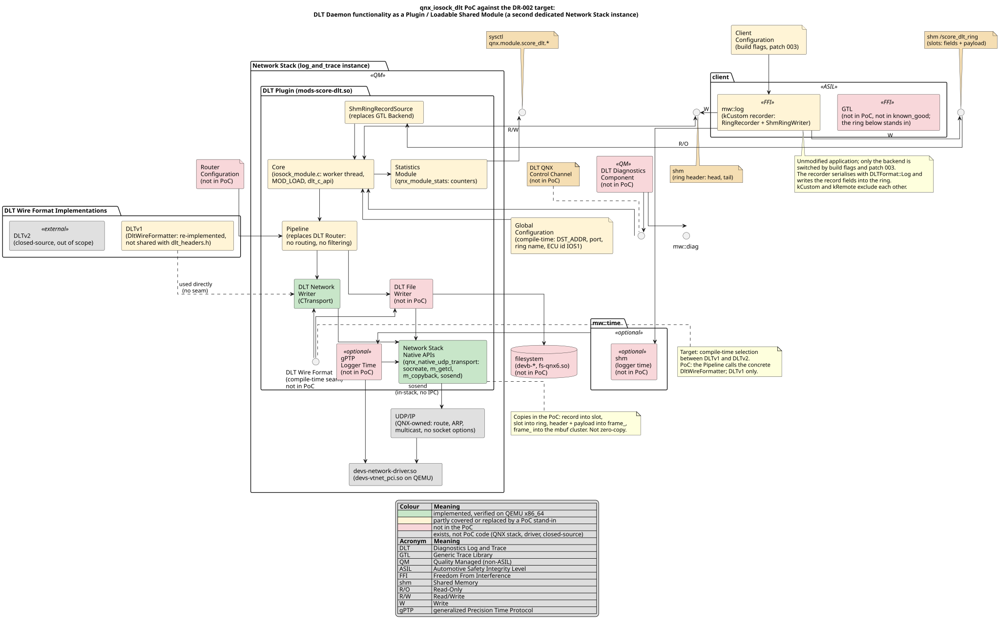
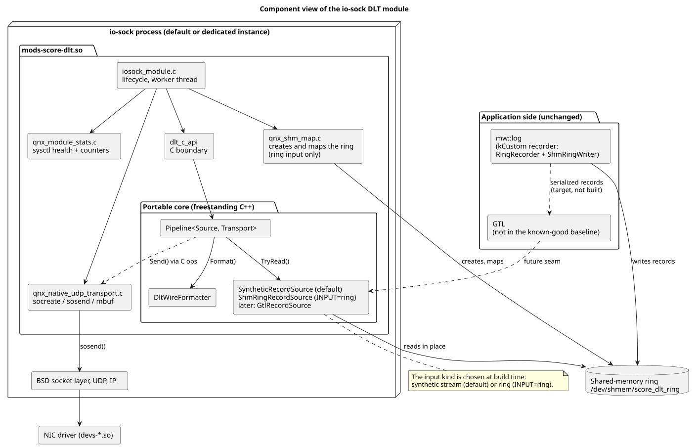
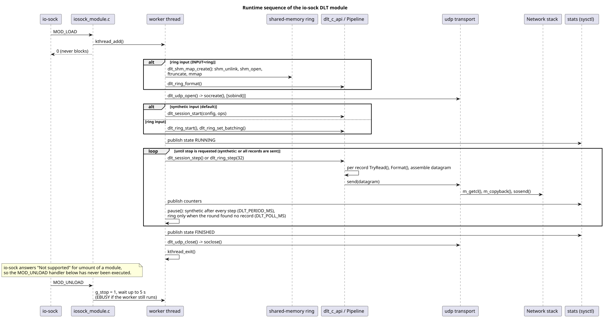

<!--
  Copyright (c) 2026 Qorix
  SPDX-License-Identifier: Apache-2.0
-->

# QNX 8.0 DLT io-sock Module

Proof of concept for part 3 of [DR-002 DLT Network Transport Evolution](https://eclipse-score.github.io/logging/main/features/logging/architecture/DR-002-dlt-network-transport.html): a custom `io-sock` module that builds DLT frames and sends them from inside the QNX network stack. It replaces the DataRouter's send path (DataRouter process -> BSD socket -> QNX IPC -> `io-sock`). The PoC shows that this works on QNX 8.0 and measures what it is worth compared with a userspace daemon.

Everything was run on QEMU (x86_64, KVM). Nothing was tested on real hardware.

## Contents

1. [Summary](#summary)
2. [Concept and Design](#concept-and-design)
3. [Build and Run](#build-and-run)
4. [Experiments and Results](#experiments-and-results)
5. [io-sock Module versus Dedicated Daemon](#io-sock-module-versus-dedicated-daemon)
6. [Known Limitations](#known-limitations)
7. [References](#references)

## Summary

### Status

| Capability | Status | Evidence |
|---|---|---|
| Portable DLT v1 formatter (freestanding C++) | Verified on Linux | 802 checks, golden bytes, independent Python decoder (`host-tests`) |
| Module builds against SDP 8.0.0 and loads | Verified on QNX x86_64 QEMU | `mount -T io-sock`, links only `libc.so.6` |
| TX from inside `io-sock` (`socreate`/`sosend`) | Verified on QEMU | stock `dlt-receive` decodes the frames (synthetic stream, `ring-regression`) |
| Input from a shared-memory ring, many producers | Verified on QEMU | 120 records from 1 + 2 producer processes (`ring-regression`, `ring-regression-batching`) |
| Unmodified `mw::log` application feeds the ring | Verified on QEMU | `kCustom` recorder, 40 records (`mwlog-regression`) |
| Userspace `sendmsg` twin for a like-for-like transport comparison | Verified on QEMU | `forwarder-functional`, `latency-forwarder`, `latency-forwarder-batching`, `cpu-forwarder`, `cpu-forwarder-batching` |
| Module in a dedicated second `io-sock` instance | Verified on QEMU (two virtio NICs) | `second-stack` |
| Module unload | **Not supported** by `io-sock` | `umount` answers "Not supported"; replacement works by restarting a dedicated stack |
| Real hardware, aarch64, real NIC driver, DMA, zero-copy | **Not tested** | |
| GTL consumer, DataRouter functions (filters, runtime levels, channels, persistence) | **Not implemented** | |

### PoC architecture



The PoC drawn in the layout of `dlt_plugin.puml` from DR-002 (same packages, components and arrows), so the two can be compared element by element. Colours show coverage: green implemented, yellow partial or stand-in, red not in the PoC, grey not PoC code. The other diagrams are listed under [Diagrams](#diagrams).

### Key results

All numbers are from QNX 8.0.0 x86_64 on QEMU/KVM with virtio-net. See [Experiments and Results](#experiments-and-results) for the full tables.

#### What was compared

Log messages (DLT) have to get from an application to the network. Three paths were measured. `[ ]` marks the socket IPC hop: the extra QNX message to the `io-sock` process that every normal process pays when it sends, and that the module avoids.

```
A  Today: DataRouter
   application -> shared memory -> DataRouter process -> socket call -> [ QNX message to io-sock ] -> network stack -> NIC

B  Forwarder: measurement twin of the module, not a product
   application -> shared-memory ring -> forwarder process -> socket call -> [ QNX message to io-sock ] -> network stack -> NIC

C  PoC: module
   application -> shared-memory ring -> module running inside io-sock -> network stack -> NIC
```

**Why the forwarder (B)?** The question behind the PoC is whether sending from inside the network stack (C) beats the normal socket call. The DataRouter (A) cannot answer that alone, because A and C differ in many things besides how they send:

| Aspect | A: DataRouter | B: Forwarder | C: Module |
|---|---|---|---|
| Where records are collected | per-process shared-memory files, read by the DataRouter | shared-memory ring | shared-memory ring |
| Recorder in the application | standard DataRouter recorder (with statistics) | ring recorder | ring recorder |
| DLT formatting code | DataRouter's (`DltLogChannel`) | PoC's `DltWireFormatter` | PoC's `DltWireFormatter` |
| Waiting before sending | three fixed 100 ms timers (10 ms when tuned) | polls every tick (about 1 ms) | polls every tick (about 1 ms) |
| Batching | packs messages up to 1472 bytes | off or 1472 bytes, set to match the module | off or 1472 bytes |
| **How it sends** | `sendmsg()` from the DataRouter process, **pays the hop** | `sendmsg()` from the forwarder process, **pays the hop** | `sosend()` inside `io-sock`, **no hop** |

B is identical to C in every row except the last, and sends the same way as A. That makes it the control experiment:

- **Without B**, a difference between C and A has too many possible causes. C delivers messages within a few ms and A in about 50 ms: is that the in-stack transport or the DataRouter's 100 ms timers? The comparison alone cannot tell.
- **With B**, it can. B delivers as fast as C, so the delay advantage comes from the timers and the ring, not from sending inside the stack. The hop only shows up in CPU: B costs about 6 µs more per datagram than C.
- B is also **the realistic alternative to the module**: a userspace daemon built the same way. Module against forwarder (C against B) is therefore the real question, whether a module is worth it compared with a daemon. [io-sock Module versus Dedicated Daemon](#io-sock-module-versus-dedicated-daemon) builds on it.

#### Terms used below

| Term | Meaning |
|---|---|
| DataRouter | The existing S-CORE daemon that collects log messages from applications, adds the DLT headers and sends them over UDP |
| Module | The PoC code loaded into the QNX network stack process (`io-sock`), which builds DLT frames and sends them directly |
| Ring | A shared-memory queue that applications write log records into and the module reads from |
| Socket IPC hop | The extra QNX message exchange needed when a normal process calls `sendmsg()`, because the network stack lives in another process |
| Batching | Packing several log messages into one network datagram (up to 1472 bytes). "Unbatched" means one message per datagram |
| Tuned DataRouter | The DataRouter restarted with 10 ms internal timers instead of its fixed 100 ms ones, to compare fairly |
| p50 / p99 | Percentiles over all messages of one run. p50 is the median. p99 is the slow tail: 99 out of 100 messages are faster. "p50 3.6 ms, p99 6.8 ms" means a typical message is 3.6 ms late and only 1 in 100 is later than 6.8 ms |
| Delay | Always the queuing delay: how much later a message reaches the host than in the best case of the same run (0 ms means no waiting). It is computed from the arrival times and the timestamps in the DLT headers (formula under [Workloads and sinks](#workloads-and-sinks)). It is not an absolute latency, because the guest and host clocks are not synchronised and the fixed part of the path (QEMU, virtio, wire) is not included. Use it to compare sinks with each other |

#### Results

| Question | Short answer | Details |
|---|---|---|
| Does it work at all? | **Yes** | The module builds frames, sends them with `sosend()` from inside the network stack, and the stock `dlt-receive` decodes them on the host. Verified with synthetic input, with processes writing to the ring, and with an unmodified `mw::log` application |
| Is the application faster when it logs? | **Yes, but partly because of the recorder** | One log call takes the application thread 16 to 37 % less time with the ring than with the default DataRouter (25 to 36 % less against the tuned DataRouter). Part of this gain comes from the ring recorder doing less work per call (no statistics reporting), not from the transport |
| Do messages arrive sooner? | **Yes against the default DataRouter, but mostly because of its timers** | The default DataRouter holds messages for up to 100 ms per stage: about 44 to 52 ms typical and 95 to 103 ms p99. The ring needs about 1.3 to 3.1 ms in the paced runs. With 10 ms timers the DataRouter needs 8 to 10 ms. **So most of the advantage comes from the DataRouter's fixed timers, not from the module's transport** (the forwarder, which uses the normal socket path, delivers as fast as the module) |
| Does it use less CPU? | **Depends on the load** | Against a tuned DataRouter, the ring with batching is on par at 1,000 messages/s and 26 to 36 % cheaper per message at 5,000 messages/s. Against the default DataRouter it is more expensive at low rates (26 to 33 % at 1,000 messages/s), because the default DataRouter saves CPU by waiting and sending few datagrams |
| What does removing the socket IPC hop save? | **About 6 to 7 µs of CPU per datagram** | Module 6.0 to 7.3 µs against forwarder 12.9 to 13.7 µs per datagram (5,000 datagrams/s and up). In cores: 0.5 points at 1,000 datagrams/s, 2.8 at 5,000, 12 at 20,000. With batching there are fewer datagrams, and the saving shrinks to 0.3 to 1.9 points of a core (9 to 19 % per message). It has no effect on delay |
| Does it copy less data? | **Not shown** | The saving does not grow with message size (384 more bytes change it by less than 1 µs), so it is a fixed cost per call, not saved copying. True zero-copy is possible in principle but not implemented and unlikely to pay off for log-sized messages, see [zero-copy analysis](#zero-copy-what-is-missing-and-whether-it-is-possible) |
| Does it lose fewer messages in bursts? | **Not against the DataRouter, yes against a plain forwarder** | The DataRouter loses messages when its own 1 MiB buffer overflows, which has nothing to do with the transport. The unbatched ring loses messages at the receiving host (UDP buffer full), and batching removes that loss. A userspace forwarder without batching drains the ring more slowly and loses 29 % of a 16 B burst (ring full), the module loses none. With batching nothing is lost anywhere |
| Can it run apart from normal networking? | **Yes** | In a second, dedicated `io-sock` instance on its own NIC, the default stack and SSH stay up, and restarting only that instance replaces the module (the module itself cannot be unloaded). Isolation comes from the dedicated stack, not from the module, so a normal daemon could use it too |

### Recommendation

The PoC shows on QEMU that the mechanism and the deployment idea work. It does not cover real hardware or the functional scope of the DataRouter.

- The module saves a fixed 6 to 7 µs per datagram: 0.5 points of a core at 1,000 datagrams/s, 12 points at 20,000. Batching cuts the number of datagrams and with it the saving.
- Most of the latency and CPU differences against the DataRouter come from its timers, recorder and consumer. These could be changed without a module.
- For other daemons (SOME/IP), start with a userspace daemon and a measurement, not a module. See [io-sock Module versus Dedicated Daemon](#io-sock-module-versus-dedicated-daemon).

The split in the PoC: `mw::log` stays the producer and serialiser, the PoC builds the DLT headers, assembles the packets and transmits them, and UDP/IP stays with QNX. [poc_architecture.svg](doc/diagrams/poc_architecture.svg) compares this with DR-002 element by element.

**Not proven:**

- Module unload (`io-sock` refuses it; replacement relies on restarting a dedicated stack).
- NIC ownership on real hardware, aarch64, a real NIC driver, DMA, TX completion, any zero-copy.
- That `socreate`/`sosend` from a module is a supported QNX interface (it works, but it is FreeBSD-internal API).
- A GTL consumer, parsing of the real `mw::log`/DataRouter format, routing, DataRouter-style statistics, runtime level control.
- Context-switch and IPC counts, fault injection inside the module, interference between the stacks.

**Main risks for a production implementation:**

- **FreeBSD-internal APIs of one `io-sock` release.** No QNX support statement, rebuild and retest for every SDP release.
- **Fault containment.** In the default stack a defect in the module stops all system networking; a dedicated second instance contains a stop, but fault injection was not tried.
- **Untrusted shared-memory input** is parsed inside a privileged process (injection, spoofed IDs, consumer stall by a dead producer); the safety and security classification is open.

## Concept and Design

### Explored options

**Option 1: reuse the DataRouter DLT code inside the module** (`DltLogChannel`, `dlt_headers.h`, `UdpStreamOutput`). Not feasible: they depend on the C++ STL, `std::mutex`, `score::os` socket wrappers, JSON configuration and `mw::log` types, and the DLT headers are GENIVI MPL-2.0 files. The module environment requires kernel-level interfaces (the [Qorix `io-sock` experiment](https://github.com/qorix-group/reference_integration/tree/prabakaran_io_sock_module_experiment) reports the same for `mw::com`). See [What a module can and cannot use](#what-a-module-can-and-cannot-use).

**Option 2: in-module DLT writer on a freestanding core (implemented).** The wire format is re-implemented as a small freestanding C++ core (no STL, exceptions, RTTI, heap, virtual functions or system headers). A thin plain-C adapter registers the module in `io-sock` and sends the finished frame with the kernel socket interface.

```
Control flow
io-sock (module loader) --> MOD_LOAD --> worker thread --> dlt_session_step() --> Pipeline
                                                                                    |
                                  RecordSource -> DltWireFormatter -> Transport (sosend)

Data flow
record payload (as produced by mw::log) --> DLT headers + payload --> mbuf --> sosend() --> UDP/IP --> NIC
```

The module has two input kinds, chosen at build time:

- **Synthetic stream** (default): the module generates the log records itself. It only proves that the transmit path works.
- **Shared-memory ring**: applications write their log records into a ring in shared memory and the module reads them from there. The application needs no socket and sends no QNX message, and no other process sits in between.

Path of a record in each variant:

```
Synthetic  module worker thread --> SyntheticRecordSource --> DltWireFormatter --> sosend()

Ring       producer process --dlt_shm_ring_write()--> /dev/shmem/score_dlt_ring --ShmRingRecordSource--> DltWireFormatter --> sosend()
```

The ring is a format of its own (a bounded lock-free queue in one shared-memory object, many producers and one consumer, layout in `include/dlt/shm_ring.h`), not the per-process `mw::log` / DataRouter ring. It carries exactly the fields of `mw::log::detail::LogEntry` that the DLT formatter needs and follows the three regions DR-002 draws for the GTL path (control block, metadata, payload), so a `mw::log` backend can write it directly. No zero-copy is claimed (what it would take, and whether it is worth it: [Zero-copy: what is missing](#zero-copy-what-is-missing-and-whether-it-is-possible)).

**Why not the per-process format.** `mw::log` writes a per-process shared-memory file (`/tmp/logging.<app_id>.<uid>.shmem`, design in `score/datarouter/doc/design/shm_apis.md`) with `std::atomic`/`std::chrono` layouts, type-registration entries, reflection-serialised `LogEntry` records and a message-passing handshake for discovery. Reading it from the module would mean re-implementing all of that. The dedicated ring has plain integer fields, no C++ ABI, many producers, one consumer, and is lock-free. This is a deliberate divergence: the per-process format stays untouched, and a `mw::log` backend or a bridge can feed the new ring later.

### Design

#### Component view



Source: [component_view.puml](doc/component_view.puml).

- **The two dashed arrows through GTL** show the target path, not the PoC. GTL is the shared-memory logging layer that DR-002 proposes. It does not exist in the `score_logging` baseline, so this path is not built. The PoC's own ring stands in for it. A GTL record source would later replace the ring source where the second dashed arrow enters the module.
- **All other arrows** show what the PoC implements (the dashed `Send()` arrow is the call from the pipeline to the transport through the C function table).

#### Runtime sequence



Source: [runtime_sequence.puml](doc/runtime_sequence.puml). Both input kinds are shown; `MOD_UNLOAD` is drawn for completeness but io-sock refuses `umount` of a module, so it has not been executed.

#### DLT frame layout

Verbose DLT v1. One message is a 22-byte header followed by the payload. Header fields are big endian, as the DataRouter writes them. The payload is passed through unchanged (little endian, as `mw::log` produces it). The module normally sends one message per UDP datagram. With batching, several complete messages, each with its own header, are placed one after another in one datagram.

| Header | Offset | Size | Field | Content |
|---|---|---|---|---|
| Standard | 0 | 1 B | `htyp` | Header type, always `0x35`: extended header present, ECU id present, timestamp present, DLT version 1 |
| | 1 | 1 B | `mcnt` | Message counter, +1 per message, wraps at 256 |
| | 2 | 2 B | `len` | Length of the whole message (22 header bytes + payload) |
| Extra | 4 | 4 B | `ecu` | ECU id, `IOS1` |
| | 8 | 4 B | `tmsp` | Timestamp in units of 0.1 ms |
| Extended | 12 | 1 B | `msin` | `(level << 4) \| 1`: log level in the upper four bits, bit 0 = 1 for verbose mode |
| | 13 | 1 B | `noar` | Number of arguments in the payload |
| | 14 | 4 B | `apid` | Application id |
| | 18 | 4 B | `ctid` | Context id |
| Payload | 22 | `len` - 22 | | Verbose arguments (type info + value each), as serialised by `mw::log` |

Reference implementation in the baseline: `score_logging/score/datarouter/include/dlt/dlt_headers.h`, `dlt_common.h`, `src/daemon/dlt_log_channel.cpp`, `src/daemon/udp_stream_output.cpp`. Default destination `239.255.42.99:3490`, ECU id `IOS1`, maximum datagram payload 1472 bytes (MTU 1500 - 20 - 8).

#### Design decisions

Each decision removes a dependency that the existing DataRouter code has and that a module cannot use (details: [What a module can and cannot use](#what-a-module-can-and-cannot-use)).

| Decision | In the module (this PoC) | In the DataRouter today | Consequence |
|---|---|---|---|
| **Portable core plus thin kernel adapter** | All DLT logic (formatter, pipeline, ring source) is a freestanding C++17 core with no QNX dependency. A small plain-C adapter reaches it only through `dlt_c_api.h` | One C++ code base that uses the STL, `std::mutex`, `score::os` socket wrappers, JSON configuration and `mw::log` types (`DltLogChannel`, `UdpStreamOutput`) | The core is tested on the host and reused by the forwarder. The price is a second implementation of the DLT header layout next to `dlt_headers.h`, so a differential test against the DataRouter output is needed |
| **Seams are templates, not virtual interfaces** | `Pipeline<Source, Transport>` accepts any type with `bool TryRead(LogRecordView&)` / `bool Send(const u8*, usize)`. No vtable is needed, because the module may not resolve `__cxa_pure_virtual` | No such restriction | A GTL source later only needs `TryRead` |
| **Interfaces use `u8*` plus size** | Plain pointer and length, no library types | `dlt_headers.h` includes `dlt_common.h` and thereby `dlt_protocol.h`, which pulls `score/span.hpp` and `<algorithm>` | Nothing from the STL or `score` libraries has to be linked into the module |

#### What a module can and cannot use

The decisions above follow from what the `io-sock` module environment allows. The tables below group this into three: constraints that shaped the design, limits of the runtime environment, and what stands between the PoC and production use. The basis column uses these tags: **code** (read in source, build files or binaries), **meas** (read in raw measurement output), **docs** (README or QNX documentation, not reproduced), **inf** (inference), **unk** (unknown), plus **EXPERIMENT** for the Qorix `io-sock` experiment. In the runtime and production tables, each tag is followed by what it refers to.

**Language, headers and libraries**

| Area | Can be used | Cannot be used or avoided | Basis |
|---|---|---|---|
| C++ language | Freestanding C++17: classes, templates, `constexpr`, `noexcept`, static storage | STL, `std::mutex`, exceptions, RTTI, heap, virtual functions (a pure virtual class references `__cxa_pure_virtual`, which the module may not resolve), static constructors. Rust was not tried | The Qorix experiment reports the STL as unusable (**EXPERIMENT**); `core_freestanding_test` (`bazel test --config=linux-x86_64 //qnx_iosock_dlt:core_freestanding_test`) proves the linked core has zero undefined symbols and no static constructors (**code**); Rust **unk** |
| Kernel headers | `devs/` headers and `<qnx/qnx_modload.h>` from plain C | Including them from C++ (FreeBSD kernel headers, assumed not C++-clean). The QNX docs say to include the `devs/` headers and not the QNX headers directly, which can cause compilation or runtime errors | QNX sample module and docs (**docs**), Qorix experiment is C (**EXPERIMENT**), C++ incompatibility not tried (**inf**) |
| Libraries | Symbols exported by `io-sock` plus a few libc symbols (`libc.so.6`) | `libstdc++`/`libc++`, `score::os` wrappers, `mw::log` types, any middleware library: existing daemon code cannot be linked and has to be re-implemented. Shared memory needed hand-written libc prototypes and hard-coded QNX constants (`O_CREAT`, `PROT_READ`, `MAP_SHARED`, LP64 `off_t`), a portability risk on aarch64 | `nm -D` comparison with the SDP's `io-sock` (**code**), see [Module ABI and kernel API](#module-abi-and-kernel-api) |
| Code reuse | Own re-implementation of the DLT headers | Not shared with `dlt_headers.h` (licence and STL): drift risk, needs a differential test against the original | **code** |

**Runtime**

| Area | Can be used | Cannot be used or avoided | Basis |
|---|---|---|---|
| Network | In-stack `socreate`/`sosend`/`m_getcl`/`m_copyback` | libc socket calls (`socket`, `sendmsg`): they would bring back the IPC hop. Only TX of one-way UDP was built; the receive path (stack input hooks, socket upcalls, TCP state) was not touched | **code**: the module's undefined symbols contain no libc socket calls (`nm -D`). The receive path was never built or run |
| Execution context, memory | A kernel-style environment inside the network stack process: mbufs, `M_NOWAIT` allocation, sysctl, `kthread`; static storage | The worker must never block the stack. Behaviour of `sosend` with unresolved ARP, no route or full queues is unverified. Dynamic allocation was not exercised | **code**: the worker design is in `iosock_module.c`. **unk**: behaviour with unresolved ARP, no route or full queues was never tested |
| Lifecycle | `MOD_LOAD` that starts a worker thread | Unload (`umount` answers "Not supported"), so `MOD_UNLOAD` is dead code. Replacing the module needs a restart of the stack, which is only acceptable for a dedicated second instance, plus a supervisor, producer re-attach and an image start-up hook, none of which exist | **meas**: on QEMU, `umount` of the module answers "Not supported". **code**: the missing supervisor, re-attach and start-up hook are not in the repository |
| Control and configuration | sysctl and shared memory | No process interface; destination, port, ring name and ECU id are compile-time in the PoC | **code**: they are build-time defines (`DST_ADDR`, `DST_PORT` and others in `qnx_module/common.mk`, `DLT_RING_NAME` and the ECU id in `iosock_module.c`) |

**Production use**

| Area | Limitation | Basis |
|---|---|---|
| API stability | `socreate`, `sosend`, `soclose`, `m_copyback`, `kthread_add` and the mbuf fields are FreeBSD-internal and not documented by QNX as module API. The module is built for one ABI (`IOSOCK_VERSION_800_V3`, FreeBSD 13.4 base) and has to be rebuilt and retested for every SDP release; the QNX docs already point to the FreeBSD 14.3 manual pages. No QNX support statement | **code**: the module's imports (`nm -D`) and its ABI version. **docs**: the QNX documentation does not describe these calls for modules |
| Fault containment | In the default stack a defect in the module (or a malicious record) stops all system networking; a second instance limits this but fault injection was not tried | **code**: the module runs inside the `io-sock` process. **unk**: no fault injection was done, so the effect of a crash is reasoned, not observed |
| Security and safety | Untrusted shared-memory input is parsed inside a privileged process (the PoC ring is world-writable, no authentication); ASIL/QM classification of code inside the network stack process is open | **code**: the ring is created with mode 0666 and has no authentication (`qnx_shm_map.c`). The classification is an open question, not a finding |
| Debuggability | Only `printf`/`slog2` and sysctl counters were used; attaching a debugger to `io-sock` and post-mortem of a crash in the module were not tried | **unk**: not tested, only `printf`/`slog2` and sysctl were used |
| Test and build | Host tests work only for the freestanding core; the module glue runs only on a target (QEMU/ITF); QNX make with `devs/mods.mk`, no Bazel target, QNX SDK and licence needed in CI | **code**: build files and test targets in the repository. **inf**: the CI requirement follows from them, it was not tried in CI |
| Hardware | NIC ownership, Plug and Play, interrupt routing and drivers of a real board are untested; a second instance needs its own NIC or VLAN | **unk**: not tested, only QEMU with virtio-net was run. **inf**: the need for a separate NIC or VLAN follows from the QNX docs, where a NIC attaches to one stack |

#### Module ABI and kernel API

| Topic | Used |
|---|---|
| ABI / registration | `IOSOCK_VERSION_CUR`, `iosock_module_version = IOSOCK_MODULE_VER_SYM_INIT`, `moduledata_t`, `MODULE_VERSION`, `DECLARE_MODULE(..., SI_SUB_PSEUDO, SI_ORDER_ANY)`, `SYSUNINIT(..., SI_SUB_DUMMY, ...)`, `<qnx/qnx_modload.h>` |
| Lifecycle | `MOD_LOAD` starts one worker (`kthread_add`), `MOD_UNLOAD` sets a stop flag and waits up to 5 s (`EBUSY` if the worker is still running) |
| Network | `socreate`, `sobind` (optional), `sosend`, `soclose`, `m_getcl(M_NOWAIT, MT_DATA, M_PKTHDR)`, `m_copyback` |
| Health / stats | `SYSCTL_NODE` / `SYSCTL_INT` under `qnx.module.score_dlt.*`, `printf` lines via `slog2info \| grep dltmod` |
| Build | QNX make: `include devs/mods.mk`, `BUILD_TYPE=SO`, `INSTALLDIR=/lib/dll`, output `mods-score-dlt.so` |

Not used: `ip_output`, `if_transmit`, manual Ethernet frames.

| API class | Items |
|---|---|
| Documented by QNX (sample module or SDK header) | module registration and ABI macros, `SYSCTL_NODE`/`SYSCTL_INT`, `m_getcl(M_NOWAIT, MT_DATA, M_PKTHDR)`, `<qnx/qnx_modload.h>`, `devs/mods.mk` |
| FreeBSD-derived internal API: exported by this `io-sock`, works on SDP 8.0.0 (FreeBSD 13.4) on QEMU, not documented as module API | `socreate`, `sobind`, `sosend`, `soclose`, `m_copyback`, `kthread_add`, `kthread_exit`, `pause_sbt`, `nanouptime`, `uma_zalloc_arg`/`zone_pack` (through the inlined `m_getcl`), mbuf header fields, `curthread` |

The in-stack socket calls were first shown by the Qorix experiment (`kso_UDP_tx_throughput.c`: UDP TX from an `io-sock` module on QEMU x86_64 and a Pi 5); this PoC built them against the SDK and ran them on QEMU.

**Checked against SDP 8.0.0.** The module compiles with the SDK's own flags (`-std=iso9899:1999 -D_KERNEL -Wall -Wmissing-prototypes -Werror`). Its undefined symbols were compared with the dynamic symbol table of `$QNX_TARGET/x86_64/sbin/io-sock`. All are exported: `socreate`, `sobind`, `sosend`, `soclose`, `m_copyback`, `kthread_add`, `kthread_exit`, `nanouptime`, `pause_sbt`, `hz`, `tick_sbt`, `printf_bsd`, `sysctl_handle_int`, `sysctl___qnx_module`, `module_register_init`, `uma_zalloc_arg`, `zone_pack` (`m_getcl` is inlined into the last two). Only `__cxa_finalize` and `__stack_chk_fail`/`__stack_chk_guard` come from `libc.so.6` (the ring variant adds a few shared-memory calls).

```bash
nm -D --undefined-only qnx_module/mods-score-dlt.so
nm -D --defined-only $QNX_TARGET/x86_64/sbin/io-sock
```

### Diagrams

| Diagram | PlantUML source | Rendered | Shows |
|---|---|---|---|
| **PoC architecture against the DR-002 target** | [poc_architecture.puml](doc/poc_architecture.puml) | [poc_architecture.svg](doc/diagrams/poc_architecture.svg) | The image from the [Summary](#poc-architecture) |
| Class diagram, page 1: overview | [class_diagram.puml](doc/class_diagram.puml) (page 1) | [overview](doc/diagrams/qnx_iosock_dlt_1_overview.svg) | All parts and how they connect |
| Class diagram, page 2: core | [class_diagram.puml](doc/class_diagram.puml) (page 2) | [core](doc/diagrams/qnx_iosock_dlt_2_core.svg) | Formatter, pipeline, record sources, transport seam |
| Class diagram, page 3: ring | [class_diagram.puml](doc/class_diagram.puml) (page 3) | [ring](doc/diagrams/qnx_iosock_dlt_3_ring.svg) | Shared-memory ring, its producers and consumer, the `mw::log` feed |
| Class diagram, page 4: boundary | [class_diagram.puml](doc/class_diagram.puml) (page 4) | [boundary](doc/diagrams/qnx_iosock_dlt_4_boundary.svg) | The C API between the core and the module |
| Class diagram, page 5: module | [class_diagram.puml](doc/class_diagram.puml) (page 5) | [module](doc/diagrams/qnx_iosock_dlt_5_module.svg) | The `io-sock` module |
| Class diagram, page 6: tools | [class_diagram.puml](doc/class_diagram.puml) (page 6) | [tools](doc/diagrams/qnx_iosock_dlt_6_tools.svg) | Userspace forwarder and host harnesses |
| Component view | [component_view.puml](doc/component_view.puml) | [component_view.svg](doc/diagrams/component_view.svg) | Module, portable core, ring, application side and the planned GTL seam ([Component view](#component-view)) |
| Runtime sequence | [runtime_sequence.puml](doc/runtime_sequence.puml) | [runtime_sequence.svg](doc/diagrams/runtime_sequence.svg) | `MOD_LOAD` to the worker loop, synthetic and ring input ([Runtime sequence](#runtime-sequence)) |
| Worker state | [worker_state.puml](doc/worker_state.puml) | [worker_state.svg](doc/diagrams/worker_state.svg) | The four states of `qnx.module.score_dlt.state` |
| Ring access | [ring_access.puml](doc/ring_access.puml) | [ring_access.svg](doc/diagrams/ring_access.svg) | Producer and worker on the shared-memory ring |

The SVG files are generated from the `doc/` directory with `java -jar plantuml.jar -tsvg -o diagrams poc_architecture.puml class_diagram.puml component_view.puml runtime_sequence.puml worker_state.puml ring_access.puml`.

### Directory structure

| Path | Content |
|---|---|
| `include/dlt/` | Headers of the portable core: formatter, pipeline, record sources, transport, stats, C API (`dlt_c_api.h`), ring layout (`shm_ring.h`, `shm_ring_source.h`) |
| `src/core/` | Portable C++ core: `dlt_wire_formatter.cpp`, `synthetic_record_source.cpp`, `dlt_c_api.cpp` |
| `src/qnx/` | Plain-C module glue: `iosock_module.c`, `qnx_native_udp_transport.c`, `qnx_module_stats.c`, `qnx_shm_map.c` (ring input only) |
| `qnx_module/` | QNX make files (`Makefile`, `common.mk`) |
| `mwlog_ring/` | `mw::log` ring recorder, example and benchmark applications |
| `tests/` | Host tests and loopback checks (formatter, ring, UDP sender, ring bridge, end-to-end scripts) |
| `tools/` | Receiver and decoder (`dlt_udp_check.py`), freestanding check, target smoke test, `ring_producer.c`, `ring_forwarder.cpp` (the `sendmsg` twin), `run_under_qemu_2nic.sh` (QEMU wrapper with two NICs), experiment scripts |
| `BUILD`, `Makefile` | Bazel targets of the host side; the Makefile does the same without Bazel (output in `out/`, not `build/`, which collides with `BUILD` on case-insensitive checkouts) and holds the QNX entry points |
| `doc/` | PlantUML sources and the rendered `diagrams/` |

The QEMU tests are outside this directory, in `feature_integration_tests/itf/`:

| Test | Covers |
|---|---|
| `test_iosock_dlt.py` | synthetic input |
| `test_iosock_dlt_ring.py` | ring input |
| `test_iosock_dlt_mwlog.py` | `mw::log` application |
| `test_iosock_dlt_forwarder.py` | userspace forwarder |
| `test_iosock_dlt_second_stack.py` | second `io-sock` instance (needs two NICs: run it under `tools/run_under_qemu_2nic.sh` with `feature_integration_tests/configs/qemu_bridge_2nic_config.json`, as experiment `second-stack` does) |
| `test_iosock_dlt_bench.py` | benchmarks |

Helpers: `bench_metrics.py` (statistics, CPU accounting, tables) and `forwarder_target.py` (controls the forwarder on the target). The host-only unit tests of `bench_metrics.py` run with `bazel test //feature_integration_tests/itf:bench_metrics_test`.

**Where to start a code review:** read `include/dlt/pipeline.h` and `dlt_wire_formatter.h` (the data path), then `include/dlt/shm_ring.h` (the ring protocol), and last `src/qnx/iosock_module.c` and `qnx_native_udp_transport.c` (the only code that touches `io-sock`).

## Build and Run

All Bazel commands run from the repository root, the QNX `make` commands from `qnx_iosock_dlt`.

### Prerequisites

You must provide a QNX Software Development Platform (SDP) 8.0.0 installation and a valid QNX licence yourself. The SDP is not part of this repository. How it is installed does not matter, as long as `source <sdp>/qnxsdp-env.sh` works in your shell and `qcc` finds the licence. The commands below assume the SDP in `~/qnx800`; adjust the path if yours differs.

Known pitfalls:

- **KVM is required.** Under QEMU software emulation (no `/dev/kvm`) the QNX x86_64 guest boots and transmits but never receives (no ARP reply, no DHCP).
- **Use libclang 18** (`LIBCLANG_PATH`). libclang 20 rejects the target triple `x86_64-pc-nto-qnx800` of the `iceoryx2-pal-posix-qnx8` build script.
- **Image inputs need LF line endings.** A CRLF `startup.sh` makes the guest skip its whole start-up.

### Host tests

The Bazel config for local Linux builds is `linux-x86_64`.

1. **Unit tests**
   ```bash
   bazel test --config=linux-x86_64 //qnx_iosock_dlt:dlt_wire_formatter_test --test_output=all
   ```

2. **Core is freestanding**
   ```bash
   bazel test --config=linux-x86_64 //qnx_iosock_dlt:core_freestanding_test --test_output=all
   ```

3. **End-to-end loopback** (formatter -> real UDP socket -> independent decoder)
   ```bash
   bazel test --config=linux-x86_64 //qnx_iosock_dlt:host_e2e_test --test_output=all
   ```

4. **Everything at once**
   ```bash
   bazel test --config=linux-x86_64 //qnx_iosock_dlt/...
   ```

### Build and load the module (QNX)

1. **Build**
   ```bash
   source ~/qnx800/qnxsdp-env.sh
   make qnx-module                        # x86_64, synthetic input
   ```
   Result: `qnx_module/mods-score-dlt.so`. The QNX make framework first names the file `libmods-score-dlt-<variant>.so`; the top-level `Makefile` cleans, builds and copies it. Options are make variables on the command line, for example `make qnx-module DST_ADDR=10.0.2.2`:

   | Option | Default | Meaning |
   |---|---|---|
   | `CPU=aarch64` | `x86_64` | target architecture |
   | `DST_ADDR=` | `239.255.42.99` | destination IPv4 address |
   | `DST_PORT=` | `3490` | destination UDP port |
   | `SRC_PORT=` | `0` | local port, 0 lets the stack choose |
   | `RECORD_COUNT=` | `10` | synthetic records to send |
   | `PERIOD_MS=` | `100` | pause between records |

   **Ring variant.** `make qnx-module-ring` builds a module that reads its records from the shared-memory ring instead of generating them. It writes `qnx_module/mods-score-dlt-ring.so` and takes these further options:

   | Option | Default | Meaning |
   |---|---|---|
   | `RING_SLOTS=` | `256` | ring slots, power of two |
   | `RING_SLOT_PAYLOAD=` | `512` | payload bytes per slot, multiple of 8 |
   | `POLL_MS=` | `1` | idle wait of the worker, rounded up to one scheduler tick |
   | `BATCH_BYTES=` | `0` | `0`: one DLT message per datagram; `1472`: pack messages into datagrams of up to that size, as the DataRouter does |

   `make qnx-tools` builds the target-side helpers `ring_producer` and `ring_forwarder` into `out/qnx_x86_64/`. Modules cannot be unloaded, so one target session can host only one module variant.

2. **Check the dependencies**: `readelf -d qnx_module/mods-score-dlt.so | grep NEEDED` must show only `libc.so.6`. A `libc++.so.2` entry means the link flags were lost (`-Wl,--as-needed` in `common.mk`).

3. **Copy to the target** (the image contains `sshd`): `scp qnx_module/mods-score-dlt.so root@<target>:/tmp_ram/`

4. **Start the receiver** before loading the module:
   ```bash
   python3 tools/dlt_udp_check.py --bind 0.0.0.0 --port 3490 --group 239.255.42.99 --count 10   # on the host
   tcpdump -i vtnet0 -n -X udp port 3490                                                          # alternative, on the target
   ```
   Multicast needs a route to the interface, as in the image's DHCP setup: `route add -net 224.0.0.0 -netmask 240.0.0.0 -interface vtnet0`. The static `network_setup.sh` has none, so use a unicast `DST_ADDR` on a connected subnet there. For Wireshark or DLT Viewer use UDP port 3490.

5. **Load**: `mount -T io-sock /tmp_ram/mods-score-dlt.so`, or at stack start `io-sock -m phy -m pci -m /tmp_ram/mods-score-dlt.so -d vtnet_pci`.

6. **Verify** (there is no unload; reboot or restart `io-sock` to remove the module):
   ```sh
   sysctl qnx.module.score_dlt                 # state 2 = finished, counters
   slog2info | grep dltmod                     # module log lines
   umount /dev/io-sock/mods-score-dlt.so       # answers "Not supported" for modules
   ```
   Or in one go: `sh tools/qnx_smoke_test.sh /tmp_ram/mods-score-dlt.so 10`, which prints one PASS/FAIL line per check (load, version visible, worker finished, counters, no failures, log lines). The final `umount` is only reported as INFO.

### Run on local QEMU (x86_64)

Uses the repository's QNX x86_64 image and the ITF QEMU runner.

- **Automated test** (ITF): `test_iosock_dlt.py` uploads the module over SFTP, runs `mount -T io-sock`, waits for the worker, captures the DLT stream on the host and checks the sysctl counters and the `DLTM`/`SYN` messages. The ITF runner creates the `tap0` network (host `169.254.21.88`, target `169.254.158.190`) itself, no sudo needed. Without `IOSOCK_DLT_MODULE` the test is skipped; `IOSOCK_DLT_RECORDS` (default 10) must match the `RECORD_COUNT` the module was built with.
  ```bash
  IOSOCK_DLT_MODULE=$PWD/qnx_iosock_dlt/qnx_module/mods-score-dlt.so \
  bazel test --config=itf-qnx-x86_64 --test_env=IOSOCK_DLT_MODULE \
      //feature_integration_tests/itf --test_output=streamed
  ```
- **Ring input:** `test_iosock_dlt_ring.py` needs the ring module and the producer built by `make qnx-tools`: set `IOSOCK_DLT_RING_MODULE` and `IOSOCK_DLT_RING_PRODUCER` (with `--test_env` for both) instead of `IOSOCK_DLT_MODULE`. The synthetic test is skipped whenever `IOSOCK_DLT_RING_MODULE` is set. The other tests are driven by `tools/run_experiments.sh`, see [Experiments and Results](#experiments-and-results).
- **Manual run:** `bazel run --config=qnx-x86_64 //images/qnx_x86_64:run` (bridge `virbr0` and sudo, see `runners/qemu_x86_64/README.md`), then `ssh root@169.254.158.190` (no password) and steps 3 to 6 of [Build and load the module (QNX)](#build-and-load-the-module-qnx). With the bridge setup, the receiver on the host listens on the bridge address.
- **aarch64 in QEMU** (optional): `bazel run --config=qnx-aarch64 //images/qnx_aarch64:run` with the module built using `CPU=aarch64`.

## Experiments and Results

`tools/run_experiments.sh` runs the verification and performance experiments on the QNX QEMU image and collects the results in one report. Every experiment has a name, listed in the [Scenario catalogue](#scenario-catalogue). Without arguments all experiments run one after the other, ordered by module variant (plain first, then batching), so the module is built at most twice.

It needs the QNX SDP sourced in the shell and KVM (see [Prerequisites](#prerequisites)). It builds the module, `ring_producer` and `ring_forwarder` itself (`make qnx-tools`) if they are missing.

```bash
source ~/qnx800/qnxsdp-env.sh
bash qnx_iosock_dlt/tools/run_experiments.sh                                    # all experiments, in catalogue order
bash qnx_iosock_dlt/tools/run_experiments.sh latency-datarouter cpu-datarouter  # only the named experiments
bash qnx_iosock_dlt/tools/run_experiments.sh --list                             # list the experiment names
```

**Output** goes to `qnx_iosock_dlt/out/experiments/<timestamp>/` (change it with `OUT_DIR`). Start with `summary.md`.

| File | Content |
|---|---|
| `summary.md` | status of every experiment and all result tables |
| `<id>_<name>/run.log` | full console output of the experiment |
| `<id>_<name>/command.txt`, `status.txt` | the commands that were run; exit code and duration |
| `<id>_<name>/test.log` | Bazel test log (QEMU experiments) |
| `<id>_<name>/results/` | `bench_results.md/.json` (latency) or `bench_cpu_results.md/.json` (CPU) |
| `<id>_<name>/module_build.log` | build log of the module variant, if it was (re)built for this experiment |

**Settings** are environment variables:

| Variable | Default | Meaning |
|---|---|---|
| `REPEATS` | 5 | repetitions of every latency scenario |
| `CPU_REPEATS` | 3 | repetitions of every CPU scenario |
| `CPU_SECONDS` | 10 | duration of one CPU measurement, in seconds |
| `DR_PERIOD_MS` | 10 | DataRouter period in the "tuned" experiments, in ms (the untuned DataRouter uses 100 ms) |
| `RING_SLOTS` | 2048 | ring slots of the module, about 1 MiB, so that the buffer capacities of the sinks compare |
| `TEST_TIMEOUT` | 3600 | Bazel test timeout per experiment, in seconds |
| `DISTDIR` | `<repo>/qnx8080` | Bazel distdir with the QNX packages |

### Scenario catalogue

All experiments pass. They ran on QNX 8.0.0 x86_64 under QEMU with KVM. "Plain" is the module without batching, "batch" the module built with `BATCH_BYTES=1472`. The Result column gives the verdict of each comparison and links to the table.

The numbers in this chapter come from one run of `run_experiments.sh` on 2026-10-12 with `REPEATS=10` and `CPU_REPEATS=5`, so they are medians of 10 latency and 5 CPU repetitions. The settings table above lists the script's defaults.

Two earlier runs (2026-10-08 and 2026-10-10) gave the same CPU figures within a few percent and the same DataRouter delay of about 50 ms. The ring's own delay differed between them (1.0 to 3.8 ms unbatched), so read it as "a few ms".

| Experiment | Scenario | Module | What it does and checks | Test selected (`-k`) | Result |
|---|---|---|---|---|---|
| `host-tests` | Host unit and loopback tests | none | `bazel test //qnx_iosock_dlt/...`: formatter, ring, recorder, loopback, freestanding check, forwarder loopback | n/a (Linux) | all pass (802 formatter and 128 ring checks, see [Host tests](#host-tests)) |
| `forwarder-functional` | Forwarder functional test | none | forwarder on its own ring, 20 records, `dlt-receive` on the host, forwarder counters add up | `forwarder` | pass |
| `ring-regression` | Ring input regression | plain | module loaded, 1 then 2 concurrent producers, 120 records through sysctl counters and `dlt-receive` | `ring` | pass |
| `mwlog-regression` | `mw::log` application feeds the ring | plain | unmodified `kCustom` application, 20 + 20 records at two contexts, debug records stay below the level | `mwlog` | pass |
| `latency-datarouter` | Latency, delivery, loss: DataRouter (100 ms periods) against ring | plain | five workload scenarios, three sinks (DataRouter 1 MiB, DataRouter 8 MiB, ring), alternating order | `bench_datarouter` | **Ring better**: delay about 2 ms against 44 to 47 ms (the DataRouter's timers), call cost 16 to 37 % lower; in the 400 B burst the DataRouter loses 62 % (its buffer), the ring 8.7 % (receiver buffer). [table](#module-against-the-datarouter) |
| `latency-datarouter-tuned` | As `latency-datarouter`, DataRouter restarted with `DR_PERIOD_MS` (10 ms) periods | plain | the fair latency comparison against a tuned DataRouter | `bench_datarouter`, `DR_PERIOD_MS` | **Ring still better, gap much smaller**: delay 2.1 to 2.9 ms against 7.8 to 9.7 ms; call cost 25 to 36 % lower. [table](#module-against-the-datarouter) |
| `cpu-datarouter` | CPU under sustained load | plain | CPU of application, DataRouter and `io-sock` per message, idle share removed | `bench_cpu` | **Not better in general**: 33 % more CPU per message at 1 kHz, 10 % more at 5 kHz for 16 B and 23 % less for 400 B. [table](#module-against-the-datarouter) |
| `latency-forwarder` | Latency, delivery, loss: module against forwarder | plain | sinks `Ring,Forwarder`, no DataRouter: the removed hop in isolation | `bench_datarouter`, `BENCH_SINKS=Ring,Forwarder` | **Same delay**; the module is better in unbatched bursts (16 B: forwarder loses 29.4 %, module 0 %). [results](#module-against-the-userspace-forwarder) |
| `cpu-forwarder` | CPU per message and per datagram: module against forwarder | plain | as `cpu-datarouter` with the forwarder sink and the extra 10 kHz and 20 kHz rates | `bench_cpu`, `CPU_HIGH_RATES=1` | **Module better**: about 6 to 7 µs less CPU per datagram (6.0 to 7.3 µs against 12.9 to 13.7 µs from 5 kHz up). [table](#module-against-the-userspace-forwarder) |
| `second-stack` | Second `io-sock` instance | plain | two NICs, module in `/alt` stack, isolation, restart of only that stack | `second_stack`, 2-NIC wrapper | pass: default stack and SSH unaffected, module replaced by restarting only the second stack |
| `ring-regression-batching` | Ring input regression | batch | as `ring-regression` with the batching module | `ring` | pass |
| `latency-batching` | As `latency-datarouter`, module with batching | batch | batching against the same DataRouter sinks | `bench_datarouter` | **Batching does not lower the delay, no burst loss**: p50 2.5 to 3.1 ms against 2.0 ms unbatched; the receiver-side burst loss of the unbatched ring is gone. [table](#module-against-the-datarouter) |
| `cpu-batching` | As `cpu-datarouter`, module with batching | batch | CPU with batching | `bench_cpu` | **Mixed**: 26 % more CPU per message than the default DataRouter at 1 kHz, 20 to 32 % less at 5 kHz. [table](#module-against-the-datarouter) |
| `cpu-batching-datarouter-tuned` | As `cpu-batching`, DataRouter restarted with `DR_PERIOD_MS` periods | batch | the fair CPU comparison: the DataRouter's 100 ms periods trade latency for CPU | `bench_cpu`, `DR_PERIOD_MS` | **Better at higher rates**: on par at 1 kHz, 26 to 36 % less CPU per message at 5 kHz. [table](#module-against-the-datarouter) |
| `latency-forwarder-batching` | As `latency-forwarder`, module and forwarder with batching | batch | `FORWARDER_BATCH=1472` | `bench_datarouter` | **No difference** between module and forwarder, no loss. Both showed 12 to 18 ms p50 in the paced runs, far above the other experiments (cause unknown, see the forwarder section). [results](#module-against-the-userspace-forwarder) |
| `cpu-forwarder-batching` | As `cpu-forwarder`, module and forwarder with batching | batch | `FORWARDER_BATCH=1472` | `bench_cpu` | **Module still cheaper, by less**: 9 to 19 % less CPU per message, 0.3 to 1.9 points of a core. [results](#module-against-the-userspace-forwarder) |

### Workloads and sinks

`test_iosock_dlt_bench.py` runs one load generator (`mwlog_bench_app`, in `mwlog_ring/`) on the QNX QEMU target against several sinks, in one target session, with identical scenarios. The module is loaded before the first run (the test starts the DataRouter if needed, as `test_remote_logging.py` does). One discarded warm-up run per sink follows; then every scenario runs `REPEATS` times on all sinks, and **the sink that goes first rotates** from scenario to scenario and repetition to repetition. All sinks therefore run with the module's idle worker polling in the background.

| Sink | Path | Config |
|---|---|---|
| DataRouter 1 MiB (old) | application -> per-process shared memory -> DataRouter (message passing, own process) -> BSD socket -> `io-sock` -> UDP | `mwlog_bench_remote.json`, `kRemote`, 1 MiB application buffer, context `REM` |
| DataRouter 8 MiB | the same with a larger application buffer, to see how much of the burst loss is buffer sizing | `mwlog_bench_remote_large.json`, 8 MiB buffer |
| Ring (new) | application -> ring recorder -> shared-memory ring -> `io-sock` module -> network stack -> UDP | `mwlog_bench_ring.json`, `kCustom`, context `RNG` |
| Forwarder | application -> ring recorder -> ring -> userspace forwarder -> `sendmsg` -> `io-sock` -> UDP | experiments `latency-forwarder`, `latency-forwarder-batching`, `cpu-forwarder`, `cpu-forwarder-batching` only, context `FWD` |

| Workload | Test | Rates and sizes |
|---|---|---|
| Latency, delivery, loss (`latency-*`) | `bench_datarouter` | paced 1 kHz with 16 and 400 byte messages, paced 5 kHz with 16 bytes, unthrottled burst of 5000 messages with 16 and 400 bytes; every message carries its sequence number |
| CPU (`cpu-*`) | `bench_cpu` | 1 kHz 16 B, 5 kHz 16 B, 5 kHz 400 B; the forwarder experiments add 10 kHz and 20 kHz with 16 B; `CPU_SECONDS` (10) each, sleep-paced so that the application is not spinning, `CPU_REPEATS` (default 3, 5 in the reported run) |

| Metric | Source | Meaning |
|---|---|---|
| call mean / p50 / p99 / max (ns) | application | Duration of one complete log statement, the cost the application thread pays per message |
| delivered, loss %, reordered | host (`dlt-receive`) | Unique sequence numbers received of those sent, and messages that arrive out of order |
| msgs/s (host) | host | Delivered messages divided by the time between the first and the last arrival |
| queuing p50 / p99 / max (ms) | host | Delay variation: `(rx_i - rx_0) - (tmsp_i - tmsp_0)` relative to its minimum. The guest and host clocks are not synchronised, so this is the queuing delay above the best case of the run, not an absolute latency |
| CPU % of one core, µs per message / datagram | `pidin` | Application CPU is read by the application itself; DataRouter, forwarder and `io-sock` (which contains the module's worker and, for the DataRouter path, the BSD socket send) from `pidin -F "%a %u %v %N"` before and after the load. The kernel samples these at the timer tick, hence the seconds-long loads. The CPU use without any application (polling) is measured first in every repetition and removed |

**Where messages are lost.** Every run counts the missing messages and subtracts those that a counter of the sink explains. The rest is `unaccounted`. The counters:

| Counter | Source | Notes |
|---|---|---|
| `app no slot`, `app too long` | the application's DataRouter recorder | Published as DLT messages (app id `BNCH`, context `STAT`) at most every 5 s, so DataRouter bursts end with a `bench-final` message after 6 s |
| `DR buffer full`, `DR invalid size` | the DataRouter's "message drop detected" messages (app id `DR`, context `STAT`) | |
| `DR send failed` | the DataRouter | Published every 10 s, so DataRouter bursts wait 11 s |
| `ring full`, `ring oversize`, `module send failed` | module sysctl deltas | |
| `module messages`, `module datagrams` | module sysctl deltas | The `packets_sent` and `datagrams_sent` deltas |
| `host UDP rcvbuf`, `tap0 rx dropped` | host counters, in datagrams | Shown next to `unaccounted`, not subtracted |

A counter that a path does not have shows as `-`, one that stayed 0 shows `0`.

**What bounds the DataRouter's delay.** The sources show three fixed 100 ms periods, none configurable: the polling of the applications' shared memory (`kTimeoutInMs` in `message_passing_server.cpp`), the loop period (`kThrottleTimeUs`) and the DLT channel flush period (`kDltFlushPeriodUs`) in `socketserver.cpp`. A message waits up to about 100 ms per stage, which fits the measured median of about 50 ms and p99 of about 100 ms. `patches/logging/004-datarouter-period-env.patch` (registered in `known_good.json`) lets `DATAROUTER_PERIOD_MS` (1 to 100) shorten the polling and loop periods and flush the channel on every loop iteration when shortened; without it nothing changes. This is how `latency-datarouter-tuned` and `cpu-batching-datarouter-tuned` run the "tuned DataRouter".

### Module against the DataRouter

Experiments: `latency-datarouter`, `latency-batching` and `latency-datarouter-tuned` for latency; `cpu-datarouter`, `cpu-batching` and `cpu-batching-datarouter-tuned` for CPU.

**Default and tuned DataRouter.** The default DataRouter is the product as it ships. It waits in three fixed periods of 100 ms (see [Workloads and sinks](#workloads-and-sinks)). The tuned DataRouter is the same program with these waits shortened to 10 ms by `patches/logging/004-datarouter-period-env.patch`. It exists because most of the ring's delay advantage over the default DataRouter comes from the 100 ms waits, not from the module; the tuned DataRouter shows what is left once the waits are removed. The price of shorter waits is more wake-ups, so more CPU at low rates.

Columns in the tables:

| Column | Meaning |
|---|---|
| DataRouter 100 ms | default DataRouter, 1 MiB application buffer |
| DataRouter 10 ms | tuned DataRouter, 1 MiB application buffer |
| Ring | module without batching |
| Ring, batching | module built with `BATCH_BYTES=1472` |

**Latency.** Each cell is: call mean / loss / queuing p50 / queuing p99 (medians of 10 repetitions). The DataRouter 100 ms and Ring columns are from `latency-datarouter`, DataRouter 10 ms from `latency-datarouter-tuned` and Ring, batching from `latency-batching`.

| Scenario | DataRouter 100 ms | DataRouter 10 ms | Ring | Ring, batching |
|---|---|---|---|---|
| paced 1k/s, 16 B | 12.5 µs / 0 % / 44.2 / 95.1 ms | 12.5 µs / 0 % / 7.8 / 15.0 ms | 9.9 µs / 0 % / 2.0 / 3.8 ms | 9.0 µs / 0 % / 3.1 / 6.4 ms |
| paced 1k/s, 400 B | 19.1 µs / 0 % / 45.3 / 95.5 ms | 18.7 µs / 0 % / 9.7 / 16.8 ms | 14.5 µs / 0 % / 2.0 / 5.3 ms | 14.1 µs / 0 % / 2.7 / 6.3 ms |
| paced 5k/s, 16 B | 8.4 µs / 0 % / 47.3 / 97.7 ms | 8.2 µs / 0 % / 7.8 / 16.7 ms | 5.8 µs / 0 % / 2.0 / 3.8 ms | 5.8 µs / 0 % / 2.5 / 4.8 ms |
| burst, 16 B | 6.1 µs / 0 % / 59.0 / 120.8 ms | 6.1 µs / 0 % / 34.2 / 83.7 ms | 3.9 µs / 0 % / 38.8 / 90.1 ms | 3.9 µs / 0 % / 39.4 / 89.2 ms |
| burst, 400 B | 9.9 µs / 61.8 % / 61.1 / 112.9 ms (survivors only) | 12.0 µs / 0 % / 45.1 / 84.5 ms | 8.3 µs / 8.7 % / 47.3 / 94.0 ms | 8.0 µs / 0 % / 48.0 / 99.5 ms |

DLT messages and datagrams sent by the module (sysctl deltas, median):

| Scenario | messages | datagrams without batching | datagrams with batching |
|---|---|---|---|
| paced 1k/s, 16 B | 3001 | 3001 | 1506 |
| paced 1k/s, 400 B | 3001 | 3001 | 1503 |
| paced 5k/s, 16 B | 10001 | 10001 | 1058 |
| burst, 16 B | 5001 | 5001 | 334 |
| burst, 400 B | 5001 | 5001 | 1730 |

- **Most of the ring's delay advantage is the DataRouter's 100 ms waits.** The default DataRouter delivers at 44 to 47 ms median and 95 to 98 ms p99 against 2.0 ms for the ring (the same DataRouter measured in `latency-batching` gave 51 to 52 ms). With 10 ms waits it needs 7.8 to 9.7 ms. The ring is still lower (2.1 to 2.9 ms in the tuned run), but the gap shrinks from about 20 times to 3 to 4 times. In the burst runs the tuned DataRouter and the ring are equal (34 to 46 ms), because the queue is bounded by the sending rate, not by the sink. The default DataRouter is slower there (59 to 61 ms).
- **Batching does not lower the ring's delay.** The batched ring had p50 2.5 to 3.1 ms against 2.0 ms unbatched (`latency-batching` against `latency-datarouter`). The earlier runs also disagreed on which of the two variants was faster, so treat them as equal. Batching does remove the receiver-side burst loss (below).
- **Cost on the application thread is lower with the ring in every scenario**: 16 to 37 % against the default DataRouter (16 % in the 400 byte burst, where the DataRouter loses messages), 25 to 36 % against the tuned one. The repetitions of the two sinks overlap, so read the percentages as indicative. The ring recorder also does less per call (no statistics reporter); that part was not isolated.
- **The DataRouter's burst loss is its buffer.** The 400 byte burst writes about 2 MB at once into the 1 MiB application buffer. The DataRouter lost 62 % at the median (53 to 77 % over the repetitions, 76 % in `latency-batching`); `DR buffer full` explains all lost messages (3092 of 3092 at the median) and there are no slot shortages, over-long messages or send failures. With 10 ms waits it loses nothing. With an 8 MiB buffer and 100 ms waits nothing is lost either, but the delay rises (p50 98 to 104 ms, p99 140 to 147 ms), still about twice that of the ring.
- **The ring's unbatched burst loss happens at the receiver.** The ring and module counters are 0; the missing messages equal the host's UDP receive buffer overflow counter exactly (8.7 % at the median in `latency-datarouter`, 9.3 % in the tuned run, 10.1 % in `latency-forwarder`; 2 to 16 % over the repetitions). The module sends one message per datagram while the DataRouter packs several into one, so it sends more datagrams in a burst and overflows the receiver's socket buffer sooner. **Batching removes it**: datagrams fall from 5001 to 1730 (400 B) and from 5001 to 334 (16 B), and nothing is lost.

**CPU.** Percent of one core (application / DataRouter / `io-sock`) and total microseconds per message, idle share removed (medians of 5 repetitions). The Ring column is from `cpu-datarouter`, Ring, batching from `cpu-batching`, DataRouter 10 ms from `cpu-batching-datarouter-tuned`.

| Scenario | DataRouter 100 ms | DataRouter 10 ms | Ring | Ring, batching |
|---|---|---|---|---|
| 1k/s, 16 B | 3.2 % (1.7 / 0.4 / 1.1), 24.7 µs | 3.9 % (1.8 / 0.9 / 1.3), 30.4 µs | 3.9 % (1.4 / 0.1 / 2.4), 32.8 µs | 3.8 % (1.4 / 0.1 / 2.3), 31.2 µs |
| 5k/s, 16 B | 6.6 % (4.0 / 1.3 / 1.3), 12.6 µs | 7.4 % (4.2 / 1.7 / 1.5), 13.8 µs | 7.2 % (3.0 / 0.1 / 4.2), 13.9 µs | 5.5 % (3.0 / 0.1 / 2.5), 10.1 µs |
| 5k/s, 400 B | 11.3 % (6.8 / 1.5 / 2.9), 23.1 µs | 12.1 % (7.0 / 1.9 / 3.2), 24.4 µs | 9.0 % (5.0 / 0.1 / 3.9), 17.8 µs | 7.9 % (5.1 / 0.1 / 2.8), 15.6 µs |

Idle, module loaded and no application: `io-sock` 0.8 to 0.9 % of a core; DataRouter 0.10 %, or 0.31 % with the 10 ms waits.

- **Against the default DataRouter the ring does not save CPU in general.** It needs 33 % more CPU per message at 1 kHz unbatched and 26 % more with batching. At 5 kHz it needs 10 % more for 16 byte messages and 23 % less for 400 bytes unbatched, and is 20 % (16 bytes) to 32 % (400 bytes) cheaper with batching.
- **That comparison is not like for like.** The default DataRouter saves CPU by holding messages for up to 100 ms and sending them in few datagrams, the same behaviour that causes its delay. The tuned DataRouter is the fair comparison: the ring with batching is on par at 1 kHz and 26 % (16 byte) to 36 % (400 byte) cheaper per message at 5 kHz. The short waits cost the DataRouter CPU at 1 kHz (30.4 µs against 24.7 µs) and when idle (0.31 % against 0.10 %).
- **Where the work goes.** The ring moves work out of the application and the DataRouter into `io-sock`, where every send is its own wake-up and datagram unless batching is on. The ring is polled every scheduler tick, which costs CPU even when idle (`io-sock` 0.8 to 0.9 % with the module loaded; how much of that is the module was not separated).
- Not measured: ring and DataRouter at the same time on the same system, loads above 5 kHz, DataRouter waits below 10 ms.

### Module against the userspace forwarder

Experiments `latency-forwarder`, `latency-forwarder-batching`, `cpu-forwarder` and `cpu-forwarder-batching`. Same ring, formatter, batching and recorder; only the transport differs (`sosend()` inside `io-sock` against `sendmsg()` from a process). Medians, 10 repetitions of latency, 5 repetitions of 10 s of CPU. The application's own CPU is equal for both sinks in every scenario.

CPU, unbatched (`cpu-forwarder`): percent of one core, and transport CPU (`io-sock` plus forwarder, idle share removed) per datagram:

| Scenario | Module | Forwarder (`sendmsg`) | Difference per datagram |
|---|---|---|---|
| 1k/s, 16 B | 3.8 %, 17.39 µs | 4.3 %, 23.19 µs | +5.8 µs |
| 5k/s, 16 B | 7.0 %, 7.16 µs | 9.8 %, 13.29 µs | +6.1 µs |
| 5k/s, 400 B | 9.0 %, 7.09 µs | 12.2 %, 13.70 µs | +6.6 µs |
| 10k/s, 16 B | 11.0 %, 6.01 µs | 17.5 %, 13.19 µs | +7.2 µs |
| 20k/s, 16 B | 20.1 %, 6.00 µs | 32.3 %, 12.87 µs | +6.9 µs |

Idle, module loaded and no application: `io-sock` 0.80 %, plus 0.25 % for the polling `ring_forwarder`.

With 1472 byte batching (`cpu-forwarder-batching`), percent of one core and total microseconds per message:

| Scenario | Module | Forwarder (`sendmsg`) | Module saves |
|---|---|---|---|
| 1k/s, 16 B | 3.6 %, 29.1 µs | 4.2 %, 36.0 µs | 0.6 points, 19 % |
| 5k/s, 16 B | 5.5 %, 9.8 µs | 5.8 %, 10.8 µs | 0.3 points, 9 % |
| 5k/s, 400 B | 7.9 %, 15.3 µs | 9.0 %, 17.8 µs | 1.1 points, 14 % |
| 10k/s, 16 B | 7.3 %, 7.1 µs | 8.1 %, 7.8 µs | 0.8 points, 9 % |
| 20k/s, 16 B | 11.2 %, 5.7 µs | 13.1 %, 6.8 µs | 1.9 points, 16 % |

- **The removed socket IPC hop is worth about 6 to 7 µs of CPU per datagram** (the ranges of the five repetitions do not overlap in any scenario). About three quarters of the extra CPU appears inside `io-sock`, the rest in the forwarder process (`pidin` attribution, tick-sampled). At 1 kHz the idle polling share dominates and the figure is less reliable.
- **Delivery delay is the same** (`latency-forwarder`, `latency-forwarder-batching`: queuing p50 and p99 equal within the run-to-run spread). The hop does not show up in latency, so the delay advantage over the DataRouter is its periods and consumer, not the transport.
- **Unbatched bursts:** the forwarder loses more. The 16 B burst loses 29.4 % (ring full, counter-matched) against 0 % for the module, which fits its per-datagram cost of about twice the module's (the ring is drained more slowly). The 400 B burst loses messages on both sides for different reasons (module: 10 % at the host's UDP receive buffer; forwarder: ring full in some repetitions, 0 to 9.9 %).
- **With 1472 byte batching the saving shrinks but does not disappear.** Batching cuts the number of datagrams, so the module saves 0.3 to 1.9 points of a core, 9 to 19 % per message, and the ranges of the repetitions do not overlap. Neither sink loses messages with batching.
- **One unexplained result.** In `latency-forwarder-batching` the module and the forwarder both showed 12 to 18 ms p50 in the paced runs, against 1.3 to 3.1 ms in the other experiments. An earlier run of the same experiment gave 1.4 to 2.6 ms. The two sinks agree with each other, so it is not the transport, but the cause (host load, guest timing) is not known.
- Single repetitions of both sinks show queuing outliers of about 1.4 s; the DataRouter runs show them too, so they look like QEMU or host stalls.

Not measured: context switches and IPC counts (the CPU difference is the proxy), real hardware and a real NIC driver. What the numbers support, in short, is under [Key results](#key-results).

## io-sock Module versus Dedicated Daemon

Analysis whether the module approach is worth repeating for other network daemons (SOME/IP, others). Tags as in [What a module can and cannot use](#what-a-module-can-and-cannot-use): **meas**, **code**, **inf** (inference, not measured), **unk**. The only like-for-like comparison available is the module against the userspace forwarder (path B in [What was compared](#what-was-compared)): same ring, formatter, batching and recorder, differing only in `sosend()` inside `io-sock` against `sendmsg()` from a process (QEMU x86_64/KVM, virtio-net, tick-sampled `pidin`).

### What the module buys

| Gain | Verdict | Evidence |
|---|---|---|
| CPU per unbatched datagram | about 6 to 7 µs less, from roughly 13 µs to roughly 6.5 µs (**meas**) | experiment `cpu-forwarder`, ranges of the repetitions do not overlap |
| CPU with batching | module still cheaper, but by less: 9 to 19 % per message, 0.3 to 1.9 points of a core (**meas**) | experiment `cpu-forwarder-batching`, ranges do not overlap |
| Latency | none visible (**meas**) | experiments `latency-forwarder` and `latency-forwarder-batching`, p50 and p99 equal |
| Drain capacity under unbatched bursts | higher (**meas**): 16 B burst loses 29.4 % with the forwarder (ring full), 0 % with the module | experiment `latency-forwarder` |
| Fewer copies | not shown, probably zero to one copy (**inf**, see below) | no copy counters; the size test below |
| Fewer context switches | plausible, not measured (**unk**) | no counters on the image |
| Isolation from other traffic | real, but separable from the module (see below) | experiment `second-stack` |
| Zero-copy | not implemented; only reachable as a module (**inf**) | four confirmed copies in the PoC |

The gain is therefore a per-datagram CPU saving. It is small at log-typical rates and grows with the datagram rate. Converted to cores with the measured medians (the extra CPU of the forwarder over the module, 16 B datagrams, percent of one core): 1 kHz 0.5 points, 5 kHz 2.8 points, 10 kHz 6.5 points, 20 kHz 12.2 points. With batching there are fewer datagrams and the gain shrinks to 0.3 to 1.9 points. The remaining 6.0 to 7.3 µs per datagram is the stack itself (UDP/IP, ARP/route, driver) and is identical for both, so the module cannot go below it.

### Why CPU time drops

A process that calls `sendmsg()` on QNX does not execute the socket code itself. The libc socket call is a QNX message to the `io-sock` resource manager, which runs the FreeBSD socket layer in its own threads. Per datagram this adds, relative to calling `sosend()` from inside `io-sock`:

| Cost per datagram | In the daemon path | In the module path |
|---|---|---|
| Kernel entry and message send to `io-sock` (`MsgSend`-style) | yes | no |
| Wake-up and dispatch of an `io-sock` thread, two context switches (client to server and back) | yes (**inf**) | no |
| Decoding the generic socket operation (descriptor and open-control-block lookup, `uio` set-up) and the reply | yes (**inf**) | no |
| Moving the payload from the client's address space into `io-sock` | yes, one transfer (**inf**, "likely" in [Data path and copies](#data-path-and-copies)) | no |
| Building the mbuf | yes (`uio` to mbuf) | yes (`m_getcl` and `m_copyback`) |
| UDP/IP, route and ARP lookup, driver | yes | yes |

Support for this reading (**meas**):

- About three quarters of the extra CPU of the forwarder shows up inside the `io-sock` process, the rest in the forwarder. The saving is mostly dispatch and decode work on the server side, not the syscall on the client side.
- The saving does not grow with the payload. At 5 kHz the forwarder costs 13.29 µs (16 B) and 13.70 µs (400 B), the module 7.16 and 7.09 µs: the difference is 6.1 and 6.6 µs, so 384 extra bytes add at most about 0.5 µs, within the run-to-run spread. A per-byte effect such as a saved memcpy would grow with the size; a fixed per-call cost does not. **The gain is a fixed cost per call, not a byte-copy saving.**
- It scales linearly with the datagram rate and shrinks when batching cuts the rate. This is what a fixed per-call cost predicts.

Not measured (**unk**): context-switch and message counts. The two context switches are the usual explanation for a per-call cost of this size, but the image has no verified instrumentation to confirm it.

### Data path and copies

How does a log message get from the application to the network stack? A `copy` duplicates the message bytes in memory, an `IPC hop` is the extra QNX message to `io-sock`. For the DataRouter only a few source files were read, so its steps marked "likely" are educated guesses. The module's steps are all confirmed in the code.

```
DataRouter path                            |  Module path
  application                              |      application
    -> shared memory     copy (likely)     |      -> recorder slot   copy
    -> DataRouter parser copy (likely)     |      -> ring slot       copy
    -> send buffer       copy (confirmed)  |      -> module worker   read in place, no copy
    -> io-sock           IPC hop (likely)  |      -> frame buffer    copy
    -> mbuf              copy (likely)     |      -> mbuf            copy
```

From the mbuf on, both paths are identical (network stack, driver, NIC). Both copy the message about four times, so copying is not where they differ. The module saves the IPC hop and the extra wake-up between application and DataRouter.

#### Why the copy count is not the argument

- The forwarder hands its buffer to `sendmsg()`, and the QNX message transfer plus `io-sock` bring it into an mbuf (one or two copies, inferred). The module therefore saves at most that one cross-process transfer, which costs well under a microsecond for 400 bytes (see the size test above).
- The module still has one copy it could avoid (build the header directly in the mbuf), but the gain would be small at 16 to 400 bytes.
- True zero-copy is the one thing only an in-stack writer can do, because a socket call always copies. It is untested and not implemented, so it is a hope, not a measured gain.

#### Zero-copy: what is missing, and whether it is possible

On the stack side it is possible in principle, but it is not demonstrated and, for DLT-sized messages, not worth it. "Zero-copy" here means no CPU copy of the serialised log bytes between the ring slot and the NIC; a software UDP checksum still reads the data.

**Evidence that the stack allows it** (SDP 8.0.0 headers and `io-sock` exports; nothing was run, the PoC never calls `m_extadd` and virtio on QEMU cannot show a DMA benefit):

- `m_extadd()` (external storage with a free callback), `mb_free_ext`, `mb_dupcl`, `m_copym`, `m_dup`, `m_defrag` and `m_collapse` are declared in `devs/sys/mbuf.h` and exported by `io-sock`. `m_extaddref()` and `EXT_EXTREF` (externally maintained reference count) are an inline function and a constant in the same header. `EXT_MOD_TYPE` is defined for a custom module's external buffer.
- `bus_dmamap_load_mbuf_sg` and `bus_dmamap_sync` are exported, so a driver can map an external mbuf for DMA in the usual FreeBSD way. DR-002 itself assumes a DMA-capable shared-memory region for the GTL path (`shm_dma_enabled`).

**The copies, and what removing each one takes**

| Copy today | Removable? | What it takes |
|---|---|---|
| Recorder's slot into the ring slot (`dlt_shm_ring_write`) | yes, no stack involved | A reserve/commit producer API: claim the ring slot first and serialise `DLTFormat::Log` output directly into it |
| Ring slot into `frame_` (`DltWireFormatter::Format`) | yes | Build the 22 byte header in a small module-owned mbuf and chain the payload behind it |
| `frame_` into the mbuf cluster (`m_copyback`) | yes, only through the stack | `m_extadd()` over the ring slot with a free callback that releases the slot |
| mbuf into the NIC | no | The one DMA transfer that remains; on QEMU virtio it is a host-side copy, so nothing is gained |

**What is missing in the PoC**

- **Slot lifetime.** A slot would stay in use until the free callback runs (TX completion, possibly late and out of order: lazy driver reclaim, the ARP queue, the multicast loopback reference). The ring needs per-slot in-flight state, a head that advances only past completed slots, a size that covers the in-flight depth, and a back-pressure policy.
- **Callback context.** The callback can run in a driver's completion thread: it must not block or allocate and may release the slot with atomics only.
- **DMA-capable memory.** The ring is ordinary POSIX shared memory. Real DMA needs memory the NIC can reach (physical addressing, IOMMU or SMMU, cache coherency on aarch64), probably `shm_ctl` flags or typed memory (**unk**), allocated by the owner of the region.
- **Batching.** N batched messages would become up to 2N segments, and NICs limit the segments per frame (beyond that `m_defrag` copies). It needs a packed, variable-length ring.
- **Trust.** The ring is world-writable, so headers must stay in module-owned memory; otherwise a producer could change `apid`, `ctid` or the length of a frame in flight.

**Worth it for DLT?** Not on the evidence. 384 more bytes add at most about 0.5 µs per datagram, whereas the stack's own work is 6.0 to 7.3 µs, and a 400 byte copy takes tens of nanoseconds (**inf**). Zero-copy adds fixed costs per message (external mbuf, reference count, free callback, extra DMA descriptor, slot bookkeeping) that are likely to match or exceed that for small messages; the break-even is probably in the kilobyte range (**inf**, not measured). The two ring-side copies are cheap to remove and risk-free for the stack, so they come first. True zero-copy belongs to large-payload paths such as the Generic Trace plugin that DR-002 keeps out of this PoC.

**Smallest experiment that would settle it:** replace `m_copyback` for one datagram by `m_extadd()` over a static buffer with `EXT_MOD_TYPE` and a counting free callback; check that the frame arrives intact and the callback runs once per datagram, and record the delay from `sosend()` to the callback. Then compare CPU per datagram against `m_copyback` at 16, 400 and 1450 bytes (the `cpu-forwarder` method) and stop if the gain is within the spread. Only after that add in-place serialisation, out-of-order slot release and DMA-capable memory on a real NIC.

### What the isolation does and does not need the module for

The second `io-sock` instance (`second-stack`) isolates log traffic from other traffic: own NIC, own queues, own `io-sock` process, restartable without restarting system networking. This does **not** require the module. A userspace daemon can use the second stack too: according to the QNX docs a process selects the stack with the `SOCK` environment variable, a thread with `setsockprefix()` (the test only used `SOCK=/alt` for `ifconfig` and `sysctl`; a socket-owning daemon on `/alt` was not tested, **inf**). So: isolation, egress shaping on the dedicated instance and fault containment of the network side are properties of the dedicated stack, not of the module. What is specific to the module is the removal of the hop and the possibility of native buffers. The fault-containment side is also worse in a module: it runs inside the stack process (a crash or a stalled lock stops the stack, a daemon crash does not).

### Consequence for other daemons (SOME/IP and others)

The 6 to 7 µs per datagram we measured belongs to DLT logging. It helps most a daemon that sends many small datagrams without batching, and it says nothing about SOME/IP in general. SOME/IP is a harder case for a module in several ways:

| Aspect | DLT logging (PoC) | SOME/IP daemon |
|---|---|---|
| Direction | only sends | sends and receives: requests and replies, events, service discovery |
| Transport | UDP multicast | UDP and TCP (connections, retransmission, sockets that wait) |
| Logic | formats a message | serialisation, service discovery state machines, timers, E2E protection, configuration |
| Batching | possible, log messages can be packed | little to pack, every message boundary and its latency matters |
| Timing | delay hardly matters | request/response latency is what users see; the effect of the hop on latency was not measured (it was zero for DLT) |
| Reuse | small freestanding core | large existing code base that cannot be linked into a module |

What the PoC shows for other daemons, and what it does not:

**Tested and working (DLT, QEMU x86_64)**

- A module sends UDP datagrams from inside `io-sock` with `socreate` and `sosend`, and a stock receiver decodes them.
- Compared with a userspace daemon of the same design, this saves about 6 to 7 µs of CPU per unbatched datagram. With batching the saving shrinks (9 to 19 % per message) and delivery delay is the same.
- A module can be fed from userspace through a shared-memory ring by several producers, without a socket or a QNX message on the producer side.
- A freestanding core without STL, exceptions or heap builds, loads and runs in the module.
- A dedicated second `io-sock` instance on its own NIC isolates the traffic from the default stack, and restarting only that instance replaces the module.

**Not tested (relevant for SOME/IP)**

- **Receiving data.** Only sending was built. Stack input hooks, socket upcalls and waking a consumer were not touched.
- **TCP.** Connection state, retransmission and sockets that wait or block were not tried, so nothing is known about locking and sleeping rules inside the stack.
- **Request/response traffic.** DLT only sends. Whether the hop matters for SOME/IP latency was not measured (it was zero for DLT).
- **Service discovery, timers and E2E protection.** Only a stateless formatter was built. Existing daemon code cannot be linked into a module, so such logic would have to be rewritten.
- **A daemon on the second stack.** A process picks its stack with `SOCK` or `setsockprefix()`, so a daemon on `/alt` should work, but only `ifconfig` and `sysctl` were run there, not a socket-owning daemon.
- **Several datagrams per call.** Whether `sendmmsg` costs one hop for N datagrams or N hops was not measured. If it is one, a userspace daemon may capture most of the module's gain.

## Known Limitations

**Platform**

- Only QEMU x86_64 with the virtio network driver was tested. Real hardware (Raspberry Pi) and aarch64 are untested.
- `socreate` and `sosend` work from the module's worker thread on SDP 8.0.0, but the QNX documentation does not describe them for modules.
- The module cannot be unloaded: `umount /dev/io-sock/mods-score-dlt.so` answers "Not supported". Removing it needs a reboot or an `io-sock` restart, and it cannot be loaded twice into one stack. `MOD_UNLOAD` is therefore never exercised.
- QNX documents running several `io-sock` instances (`io-sock -o prefix=/alt`, NICs bound with `qnxdev=`; Plug and Play has to be disabled in some cases, for example for NICs of the same type). It worked on QEMU with two virtio NICs (`second-stack`); real hardware is untested.
- The C++ part of the build gets `CXXFLAGS` but not `CCFLAGS`, so the `mods.mk` flags do not apply to it. The core needs none of them.

**Sending**

- One DLT message per datagram unless built with `BATCH_BYTES`. No fragmentation.
- The MTU is fixed (payload 1472). The interface MTU is not queried, `IP_DONTFRAG` is not set, and VLAN or tunnel overhead is ignored.
- No `IP_MULTICAST_IF`: the routing table picks the interface.
- A TX error (`ENOBUFS` from `m_getcl(M_NOWAIT)`, a refused `sosend`) counts every message in that datagram as a send failure. There is no retry and no mbuf limit. What `sosend` does under load with an unresolved ARP entry or no route is unverified.
- The synthetic input has one static session, is not thread safe, and its timestamps start at load and advance by a fixed step.
- The sysctl counters are 32 bit and saturate.

**Ring input and `mw::log`**

- There is no GTL client to connect: the `shm_dma_enabled` flag in `score_logging` points at `//score/mw/log/detail/dlt_trace`, which does not exist in the baseline. The ring stands in for it.
- An application uses either the ring recorder (`kCustom`) or `kRemote`, not both; the recorder factory refuses to start with both. A ring-fed application is invisible to the DataRouter, so its per-application and per-context levels and diagnostic jobs do not apply. Only the static `mw::log` configuration filters.
- Building the recorder needs patch `003-expose-dlt-content-formatting` and the flags `KCustom_Logging` and `custom_recorder_impl`.
- Records dropped before formatting (ring full, too long, no slot in the producer) leave no `mcnt` gap and no DLT statistics message. A receiver cannot see them; only sysctl does. Payloads above 1450 bytes (22 + payload > 1472) are counted as `packets_dropped`, not as `ring_drops_oversize`.
- Timestamps are the producer's `CLOCK_MONOTONIC` in 0.1 ms, 32 bit, and wrap. Whether all producers share an origin with the DataRouter's timestamps was not checked.

**Robustness of the ring**

- The module is the only consumer by design, but nothing enforces it: a second consumer or module instance would corrupt `dequeue_pos`. A hostile producer can also reorder or replay records through the shared control block.
- The counters are plain `static int` without atomics, and `g_stop` and `g_worker_done` are `volatile` without barriers. Each has a single writer.
- The ring mapping is never unmapped and the shared-memory object never unlinked (a stale object is replaced at the next load).

### Open architecture questions

- **GTL consumer.** Does the plugin read the GTL region directly (it needs a stable layout, which the baseline lacks), or does a userspace process own GTL and feed a plugin-owned ring? Who creates the shared memory and who may attach?
- **Control plane.** Which DataRouter functions (levels and filters in `DltLogServer`, statistics, file and persistent writers) move into the plugin, and which stay in a userspace control plane that pushes a table to it? Whether that is a slimmed DataRouter is the key functional decision.
- **Support status.** Will QNX document or support in-stack socket APIs for modules, or is another supported hook needed?
- **Traffic profile.** Does production logging need one datagram per message, or is batching acceptable? That decides whether the hop saving matters at all.

## References

a. https://eclipse-score.github.io/logging/main/features/logging/architecture/DR-002-dlt-network-transport.html

b. https://www.qnx.com/developers/docs/8.0/com.qnx.doc.neutrino.io_sock/topic/overview_Architecture_iosock.html

c. https://www.qnx.com/developers/docs/8.0/com.qnx.doc.neutrino.io_sock/topic/sample_module.html

d. https://www.qnx.com/developers/docs/8.0/com.qnx.doc.neutrino.io_sock/topic/start_io-sock.html

e. https://github.com/qorix-group/reference_integration/tree/prabakaran_io_sock_module_experiment (custom io-sock module experiment, `integration/io_sock_module`)
